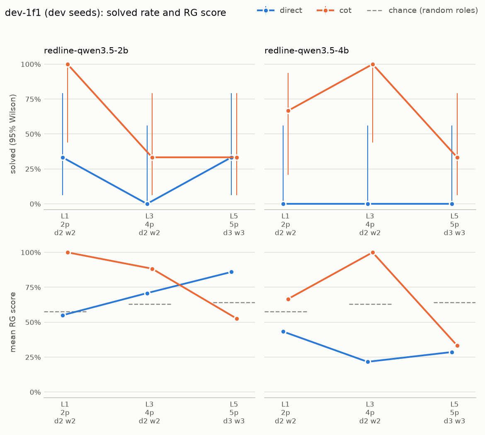

# Ladder report: dev-1f1

**DEV seeds 10-12: for tuning and pipeline checks, not a reported result.**

| | |
|---|---|
| Commit | `41a0867582c9` |
| Generator | reasoning_gym/knights_knaves |
| Models | `ollama/redline-qwen3.5-2b` (Modelfile sha256 `cc1347648a52`) `ollama/redline-qwen3.5-4b` (Modelfile sha256 `bc663cb5c657`) |
| Strategies | direct, cot |
| Ladder | levels 1, 3, 5, 3 seeds per level; a climb stops after 3 consecutive levels with nothing solved |
| Budget | reasoning strategies 4,096 output tokens per sample (512 reserve); direct 512 in one call |
| Runtime | 53 min 40 s over 1 session |
| Software | inspect_ai 0.3.278, z3 5.1.0, reasoning_gym 0.1.25, Python 3.12.14 |

## Solved rate by level

Context-limited samples are harness failures (the context window cut the model off before its budget ran out). They are excluded from every column but their own. Intervals are 95% Wilson. Levels a ladder never reached are absent, not zero. RG score is Reasoning Gym's partial credit for the extracted "Answer:" line (for knights and knaves, 0.3 + 0.7 x the share of roles right when at least one is). Chance is what random roles would score on average; an answer with no "Answer:" line scores 0, so a strategy can land below chance.

| Generator | Model | Strategy | Level | Size | n | Ctx-lim. | Solved | 95% CI | RG score | Chance | Format OK | Forced | Overrun | Out tokens | Seconds |
|---|---|---|---|---|---|---|---|---|---|---|---|---|---|---|---|
| knights_knaves | redline-qwen3.5-2b | direct | 1 | 2p d2 w2 | 3 | 0 | 1/3 | 6%-79% | 55% | 57% | 100% | 0% | 0% | 15 | 8 |
| knights_knaves | redline-qwen3.5-2b | direct | 3 | 4p d2 w2 | 3 | 0 | 0/3 | 0%-56% | 71% | 63% | 100% | 0% | 0% | 24 | 2 |
| knights_knaves | redline-qwen3.5-2b | direct | 5 | 5p d3 w3 | 3 | 0 | 1/3 | 6%-79% | 86% | 64% | 100% | 0% | 0% | 30 | 6 |
| knights_knaves | redline-qwen3.5-2b | cot | 1 | 2p d2 w2 | 3 | 0 | 3/3 | 44%-100% | 100% | 57% | 100% | 33% | n/a | 1,723 | 65 |
| knights_knaves | redline-qwen3.5-2b | cot | 3 | 4p d2 w2 | 3 | 0 | 1/3 | 6%-79% | 88% | 63% | 100% | 67% | n/a | 2,924 | 117 |
| knights_knaves | redline-qwen3.5-2b | cot | 5 | 5p d3 w3 | 3 | 0 | 1/3 | 6%-79% | 53% | 64% | 67% | 67% | n/a | 3,106 | 136 |
| knights_knaves | redline-qwen3.5-4b | direct | 1 | 2p d2 w2 | 3 | 0 | 0/3 | 0%-56% | 43% | 57% | 100% | 0% | 0% | 15 | 7 |
| knights_knaves | redline-qwen3.5-4b | direct | 3 | 4p d2 w2 | 3 | 0 | 0/3 | 0%-56% | 22% | 63% | 67% | 0% | 0% | 24 | 5 |
| knights_knaves | redline-qwen3.5-4b | direct | 5 | 5p d3 w3 | 3 | 0 | 0/3 | 0%-56% | 29% | 64% | 33% | 0% | 33% | 199 | 21 |
| knights_knaves | redline-qwen3.5-4b | cot | 1 | 2p d2 w2 | 3 | 0 | 2/3 | 21%-94% | 67% | 57% | 100% | 0% | n/a | 858 | 85 |
| knights_knaves | redline-qwen3.5-4b | cot | 3 | 4p d2 w2 | 3 | 0 | 3/3 | 44%-100% | 100% | 63% | 100% | 0% | n/a | 1,846 | 179 |
| knights_knaves | redline-qwen3.5-4b | cot | 5 | 5p d3 w3 | 3 | 0 | 1/3 | 6%-79% | 33% | 64% | 33% | 67% | n/a | 3,717 | 437 |

## Ladders

| Model | Strategy | Levels run | Stop | Detail |
|---|---|---|---|---|
| redline-qwen3.5-2b | direct | L1 1/3, L3 0/3, L5 1/3 | completed | climbed every level |
| redline-qwen3.5-2b | cot | L1 3/3, L3 1/3, L5 1/3 | completed | climbed every level |
| redline-qwen3.5-4b | direct | L1 0/3, L3 0/3, L5 0/3 | early_stop | nothing solved at levels 1, 3, 5 |
| redline-qwen3.5-4b | cot | L1 2/3, L3 3/3, L5 1/3 | completed | climbed every level |

## Harness health

- Context-limited samples: **0 of 36** (excluded from accuracy).
- Errored cells: none.
- Strategy fidelity: direct answers without reasoning in one call capped at the 512-token reserve. Overrun is the share of replies cut off there (the main signal); the median output should also stay at most 300 tokens.
  - redline-qwen3.5-2b on knights_knaves: overrun 0%, median 24 tokens over 9 samples, ok
  - redline-qwen3.5-4b on knights_knaves: overrun 11%, median 23 tokens over 9 samples, **FLAG**
- Format OK, forced answer and truncated are shares of the samples that were not context-limited. A forced answer means a reasoning call hit its cap and the reserve forced a final answer; direct is never forced (it overruns instead).

| Model | Strategy | Samples | Ctx-lim. | Format OK | Forced answer | Truncated | Sample time |
|---|---|---|---|---|---|---|---|
| redline-qwen3.5-2b | direct | 9 | 0 | 100% | 0% | 0% | 48 s |
| redline-qwen3.5-2b | cot | 9 | 0 | 89% | 56% | 11% | 15 min 56 s |
| redline-qwen3.5-4b | direct | 9 | 0 | 67% | 0% | 11% | 1 min 39 s |
| redline-qwen3.5-4b | cot | 9 | 0 | 78% | 22% | 22% | 35 min 03 s |
