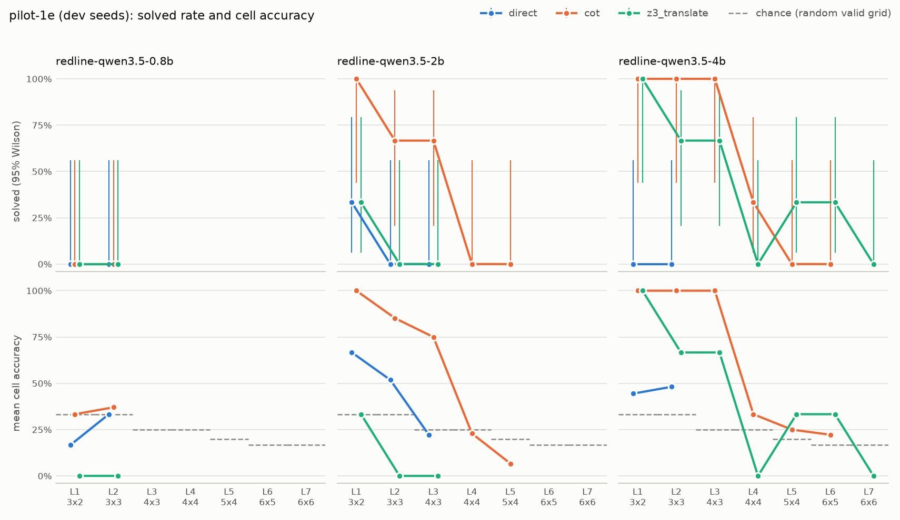

# Ladder report: pilot-1e

**DEV seeds 0-2: for tuning and pipeline checks, not a reported result.**

| | |
|---|---|
| Commit | `4ec1241b683b` |
| Models | `ollama/redline-qwen3.5-0.8b` (Modelfile sha256 `39fe9d6b971f`) `ollama/redline-qwen3.5-2b` (Modelfile sha256 `cc1347648a52`) `ollama/redline-qwen3.5-4b` (Modelfile sha256 `bc663cb5c657`) |
| Strategies | direct, cot, z3_translate |
| Ladder | levels 1-7, 3 seeds per level; a climb stops after 2 consecutive levels with nothing solved |
| Budget | 4,096 output tokens per sample (512 reserve) |
| Runtime | 2 h 22 min over 1 session |
| Software | inspect_ai 0.3.278, z3 5.1.0, Python 3.12.14 |

## Solved rate by level

Context-limited samples are harness failures (the context window cut the model off before its budget ran out). They are excluded from every column but their own. Intervals are 95% Wilson. Levels a ladder never reached are absent, not zero. Chance is the cell accuracy a random valid grid would get (1/houses); an answer that fails to parse scores 0 cells, so a strategy can land below chance.

| Model | Strategy | Level | Grid | n | Ctx-lim. | Solved | 95% CI | Cell acc. | Chance | Format OK | Forced | Out tokens | Seconds |
|---|---|---|---|---|---|---|---|---|---|---|---|---|---|
| redline-qwen3.5-0.8b | direct | 1 | 3x2 | 3 | 0 | 0/3 | 0%-56% | 17% | 33% | 67% | 0% | 57 | 2 |
| redline-qwen3.5-0.8b | direct | 2 | 3x3 | 3 | 0 | 0/3 | 0%-56% | 33% | 33% | 67% | 0% | 77 | 1 |
| redline-qwen3.5-0.8b | cot | 1 | 3x2 | 3 | 0 | 0/3 | 0%-56% | 33% | 33% | 67% | 100% | 3,793 | 89 |
| redline-qwen3.5-0.8b | cot | 2 | 3x3 | 3 | 0 | 0/3 | 0%-56% | 37% | 33% | 67% | 100% | 3,660 | 81 |
| redline-qwen3.5-0.8b | z3_translate | 1 | 3x2 | 3 | 0 | 0/3 | 0%-56% | 0% | 33% | 0% | 0% | 91 | 2 |
| redline-qwen3.5-0.8b | z3_translate | 2 | 3x3 | 3 | 0 | 0/3 | 0%-56% | 0% | 33% | 0% | 0% | 146 | 3 |
| redline-qwen3.5-2b | direct | 1 | 3x2 | 3 | 0 | 1/3 | 6%-79% | 67% | 33% | 100% | 0% | 69 | 4 |
| redline-qwen3.5-2b | direct | 2 | 3x3 | 3 | 0 | 0/3 | 0%-56% | 52% | 33% | 100% | 0% | 98 | 4 |
| redline-qwen3.5-2b | direct | 3 | 4x3 | 3 | 0 | 0/3 | 0%-56% | 22% | 25% | 100% | 0% | 119 | 4 |
| redline-qwen3.5-2b | cot | 1 | 3x2 | 3 | 0 | 3/3 | 44%-100% | 100% | 33% | 100% | 0% | 1,297 | 46 |
| redline-qwen3.5-2b | cot | 2 | 3x3 | 3 | 0 | 2/3 | 21%-94% | 85% | 33% | 100% | 67% | 3,292 | 139 |
| redline-qwen3.5-2b | cot | 3 | 4x3 | 3 | 0 | 2/3 | 21%-94% | 75% | 25% | 100% | 100% | 3,689 | 153 |
| redline-qwen3.5-2b | cot | 4 | 4x4 | 3 | 0 | 0/3 | 0%-56% | 23% | 25% | 67% | 100% | 3,716 | 151 |
| redline-qwen3.5-2b | cot | 5 | 5x4 | 3 | 0 | 0/3 | 0%-56% | 7% | 20% | 33% | 100% | 3,747 | 168 |
| redline-qwen3.5-2b | z3_translate | 1 | 3x2 | 3 | 0 | 1/3 | 6%-79% | 33% | 33% | 33% | 0% | 243 | 12 |
| redline-qwen3.5-2b | z3_translate | 2 | 3x3 | 3 | 0 | 0/3 | 0%-56% | 0% | 33% | 0% | 0% | 266 | 12 |
| redline-qwen3.5-2b | z3_translate | 3 | 4x3 | 3 | 0 | 0/3 | 0%-56% | 0% | 25% | 0% | 0% | 323 | 27 |
| redline-qwen3.5-4b | direct | 1 | 3x2 | 3 | 0 | 0/3 | 0%-56% | 44% | 33% | 100% | 0% | 86 | 16 |
| redline-qwen3.5-4b | direct | 2 | 3x3 | 3 | 0 | 0/3 | 0%-56% | 48% | 33% | 100% | 0% | 111 | 14 |
| redline-qwen3.5-4b | cot | 1 | 3x2 | 3 | 0 | 3/3 | 44%-100% | 100% | 33% | 100% | 0% | 871 | 96 |
| redline-qwen3.5-4b | cot | 2 | 3x3 | 3 | 0 | 3/3 | 44%-100% | 100% | 33% | 100% | 33% | 2,217 | 235 |
| redline-qwen3.5-4b | cot | 3 | 4x3 | 3 | 0 | 3/3 | 44%-100% | 100% | 25% | 100% | 67% | 3,046 | 370 |
| redline-qwen3.5-4b | cot | 4 | 4x4 | 3 | 0 | 1/3 | 6%-79% | 33% | 25% | 33% | 100% | 3,984 | 266 |
| redline-qwen3.5-4b | cot | 5 | 5x4 | 3 | 0 | 0/3 | 0%-56% | 25% | 20% | 33% | 100% | 3,998 | 252 |
| redline-qwen3.5-4b | cot | 6 | 6x5 | 3 | 0 | 0/3 | 0%-56% | 22% | 17% | 67% | 100% | 3,967 | 273 |
| redline-qwen3.5-4b | z3_translate | 1 | 3x2 | 3 | 0 | 3/3 | 44%-100% | 100% | 33% | 100% | 0% | 200 | 29 |
| redline-qwen3.5-4b | z3_translate | 2 | 3x3 | 3 | 0 | 2/3 | 21%-94% | 67% | 33% | 67% | 0% | 301 | 27 |
| redline-qwen3.5-4b | z3_translate | 3 | 4x3 | 3 | 0 | 2/3 | 21%-94% | 67% | 25% | 67% | 0% | 465 | 38 |
| redline-qwen3.5-4b | z3_translate | 4 | 4x4 | 3 | 0 | 0/3 | 0%-56% | 0% | 25% | 0% | 0% | 645 | 39 |
| redline-qwen3.5-4b | z3_translate | 5 | 5x4 | 3 | 0 | 1/3 | 6%-79% | 33% | 20% | 33% | 0% | 950 | 67 |
| redline-qwen3.5-4b | z3_translate | 6 | 6x5 | 3 | 0 | 1/3 | 6%-79% | 33% | 17% | 33% | 0% | 1,606 | 101 |
| redline-qwen3.5-4b | z3_translate | 7 | 6x6 | 3 | 0 | 0/3 | 0%-56% | 0% | 17% | 0% | 0% | 1,841 | 111 |

## Ladders

| Model | Strategy | Levels run | Stop | Detail |
|---|---|---|---|---|
| redline-qwen3.5-0.8b | direct | L1 0/3, L2 0/3 | early_stop | nothing solved at levels 1, 2 |
| redline-qwen3.5-0.8b | cot | L1 0/3, L2 0/3 | early_stop | nothing solved at levels 1, 2 |
| redline-qwen3.5-0.8b | z3_translate | L1 0/3, L2 0/3 | early_stop | nothing solved at levels 1, 2 |
| redline-qwen3.5-2b | direct | L1 1/3, L2 0/3, L3 0/3 | early_stop | nothing solved at levels 2, 3 |
| redline-qwen3.5-2b | cot | L1 3/3, L2 2/3, L3 2/3, L4 0/3, L5 0/3 | early_stop | nothing solved at levels 4, 5 |
| redline-qwen3.5-2b | z3_translate | L1 1/3, L2 0/3, L3 0/3 | early_stop | nothing solved at levels 2, 3 |
| redline-qwen3.5-4b | direct | L1 0/3, L2 0/3 | early_stop | nothing solved at levels 1, 2 |
| redline-qwen3.5-4b | cot | L1 3/3, L2 3/3, L3 3/3, L4 1/3, L5 0/3, L6 0/3 | early_stop | nothing solved at levels 5, 6 |
| redline-qwen3.5-4b | z3_translate | L1 3/3, L2 2/3, L3 2/3, L4 0/3, L5 1/3, L6 1/3, L7 0/3 | completed | climbed every level |

## Harness health

- Context-limited samples: **0 of 96** (excluded from accuracy).
- Errored cells: none.
- Format OK, forced answer and truncated are shares of the samples that were not context-limited. A forced answer means the reasoning call hit its cap and the reserve forced a final answer.

| Model | Strategy | Samples | Ctx-lim. | Format OK | Forced answer | Truncated | Sample time |
|---|---|---|---|---|---|---|---|
| redline-qwen3.5-0.8b | direct | 6 | 0 | 67% | 0% | 0% | 12 s |
| redline-qwen3.5-0.8b | cot | 6 | 0 | 67% | 100% | 17% | 8 min 30 s |
| redline-qwen3.5-0.8b | z3_translate | 6 | 0 | 0% | 0% | 0% | 14 s |
| redline-qwen3.5-2b | direct | 9 | 0 | 100% | 0% | 0% | 36 s |
| redline-qwen3.5-2b | cot | 15 | 0 | 80% | 73% | 0% | 32 min 49 s |
| redline-qwen3.5-2b | z3_translate | 9 | 0 | 11% | 0% | 0% | 2 min 32 s |
| redline-qwen3.5-4b | direct | 6 | 0 | 100% | 0% | 0% | 1 min 30 s |
| redline-qwen3.5-4b | cot | 18 | 0 | 72% | 67% | 28% | 1 h 14 min |
| redline-qwen3.5-4b | z3_translate | 21 | 0 | 43% | 0% | 0% | 20 min 33 s |
