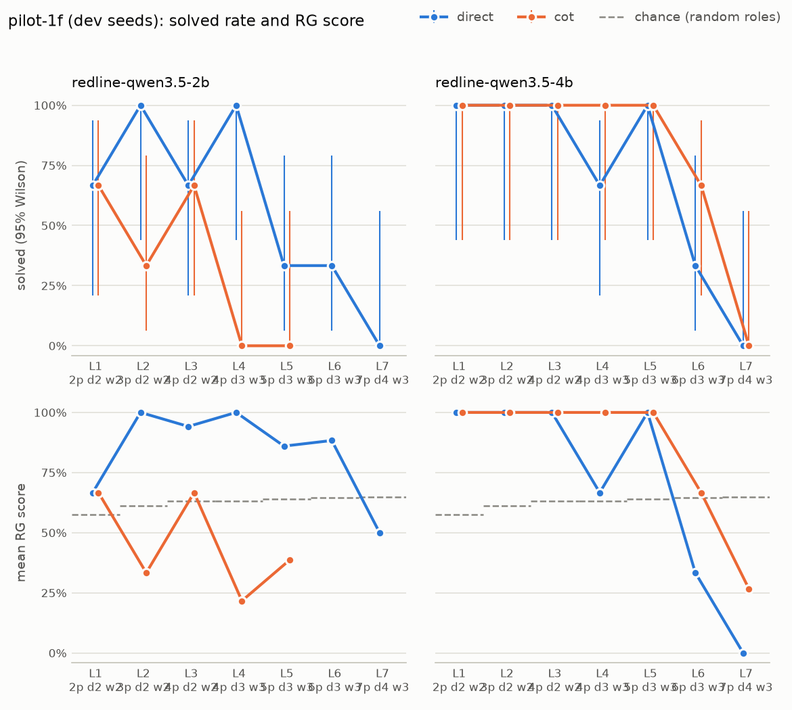

# Ladder report: pilot-1f

**DEV seeds 0-2: for tuning and pipeline checks, not a reported result.**

| | |
|---|---|
| Commit | `35f487f66e7f` |
| Generator | reasoning_gym/knights_knaves |
| Models | `ollama/redline-qwen3.5-2b` (Modelfile sha256 `cc1347648a52`) `ollama/redline-qwen3.5-4b` (Modelfile sha256 `bc663cb5c657`) |
| Strategies | direct, cot |
| Ladder | levels 1-7, 3 seeds per level; a climb stops after 2 consecutive levels with nothing solved |
| Budget | 4,096 output tokens per sample (512 reserve) |
| Runtime | 3 h 31 min over 1 session |
| Software | inspect_ai 0.3.278, z3 5.1.0, reasoning_gym 0.1.25, Python 3.12.14 |

## Solved rate by level

Context-limited samples are harness failures (the context window cut the model off before its budget ran out). They are excluded from every column but their own. Intervals are 95% Wilson. Levels a ladder never reached are absent, not zero. RG score is Reasoning Gym's partial credit for the extracted "Answer:" line (for knights and knaves, 0.3 + 0.7 x the share of roles right when at least one is). Chance is what random roles would score on average; an answer with no "Answer:" line scores 0, so a strategy can land below chance.

| Generator | Model | Strategy | Level | Size | n | Ctx-lim. | Solved | 95% CI | RG score | Chance | Format OK | Forced | Out tokens | Seconds |
|---|---|---|---|---|---|---|---|---|---|---|---|---|---|---|
| knights_knaves | redline-qwen3.5-2b | direct | 1 | 2p d2 w2 | 3 | 0 | 2/3 | 21%-94% | 67% | 57% | 67% | 0% | 1,104 | 49 |
| knights_knaves | redline-qwen3.5-2b | direct | 2 | 3p d2 w2 | 3 | 0 | 3/3 | 44%-100% | 100% | 61% | 100% | 0% | 2,217 | 101 |
| knights_knaves | redline-qwen3.5-2b | direct | 3 | 4p d2 w2 | 3 | 0 | 2/3 | 21%-94% | 94% | 63% | 100% | 33% | 2,951 | 122 |
| knights_knaves | redline-qwen3.5-2b | direct | 4 | 4p d3 w3 | 3 | 0 | 3/3 | 44%-100% | 100% | 63% | 100% | 33% | 2,100 | 87 |
| knights_knaves | redline-qwen3.5-2b | direct | 5 | 5p d3 w3 | 3 | 0 | 1/3 | 6%-79% | 86% | 64% | 100% | 100% | 3,613 | 157 |
| knights_knaves | redline-qwen3.5-2b | direct | 6 | 6p d3 w3 | 3 | 0 | 1/3 | 6%-79% | 88% | 65% | 100% | 100% | 3,620 | 156 |
| knights_knaves | redline-qwen3.5-2b | direct | 7 | 7p d4 w3 | 3 | 0 | 0/3 | 0%-56% | 50% | 65% | 100% | 100% | 3,634 | 160 |
| knights_knaves | redline-qwen3.5-2b | cot | 1 | 2p d2 w2 | 3 | 0 | 2/3 | 21%-94% | 67% | 57% | 67% | 33% | 2,048 | 126 |
| knights_knaves | redline-qwen3.5-2b | cot | 2 | 3p d2 w2 | 3 | 0 | 1/3 | 6%-79% | 33% | 61% | 33% | 67% | 3,502 | 197 |
| knights_knaves | redline-qwen3.5-2b | cot | 3 | 4p d2 w2 | 3 | 0 | 2/3 | 21%-94% | 67% | 63% | 67% | 67% | 3,205 | 175 |
| knights_knaves | redline-qwen3.5-2b | cot | 4 | 4p d3 w3 | 3 | 0 | 0/3 | 0%-56% | 22% | 63% | 33% | 100% | 3,941 | 236 |
| knights_knaves | redline-qwen3.5-2b | cot | 5 | 5p d3 w3 | 3 | 0 | 0/3 | 0%-56% | 39% | 64% | 67% | 100% | 3,623 | 193 |
| knights_knaves | redline-qwen3.5-4b | direct | 1 | 2p d2 w2 | 3 | 0 | 3/3 | 44%-100% | 100% | 57% | 100% | 0% | 1,183 | 79 |
| knights_knaves | redline-qwen3.5-4b | direct | 2 | 3p d2 w2 | 3 | 0 | 3/3 | 44%-100% | 100% | 61% | 100% | 0% | 916 | 60 |
| knights_knaves | redline-qwen3.5-4b | direct | 3 | 4p d2 w2 | 3 | 0 | 3/3 | 44%-100% | 100% | 63% | 100% | 33% | 2,400 | 162 |
| knights_knaves | redline-qwen3.5-4b | direct | 4 | 4p d3 w3 | 3 | 0 | 2/3 | 21%-94% | 67% | 63% | 67% | 33% | 3,102 | 196 |
| knights_knaves | redline-qwen3.5-4b | direct | 5 | 5p d3 w3 | 3 | 0 | 3/3 | 44%-100% | 100% | 64% | 100% | 0% | 2,585 | 170 |
| knights_knaves | redline-qwen3.5-4b | direct | 6 | 6p d3 w3 | 3 | 0 | 1/3 | 6%-79% | 33% | 65% | 33% | 67% | 3,283 | 244 |
| knights_knaves | redline-qwen3.5-4b | direct | 7 | 7p d4 w3 | 3 | 0 | 0/3 | 0%-56% | 0% | 65% | 0% | 100% | 4,096 | 307 |
| knights_knaves | redline-qwen3.5-4b | cot | 1 | 2p d2 w2 | 3 | 0 | 3/3 | 44%-100% | 100% | 57% | 100% | 0% | 1,153 | 109 |
| knights_knaves | redline-qwen3.5-4b | cot | 2 | 3p d2 w2 | 3 | 0 | 3/3 | 44%-100% | 100% | 61% | 100% | 33% | 1,876 | 131 |
| knights_knaves | redline-qwen3.5-4b | cot | 3 | 4p d2 w2 | 3 | 0 | 3/3 | 44%-100% | 100% | 63% | 100% | 0% | 1,664 | 105 |
| knights_knaves | redline-qwen3.5-4b | cot | 4 | 4p d3 w3 | 3 | 0 | 3/3 | 44%-100% | 100% | 63% | 100% | 0% | 2,468 | 167 |
| knights_knaves | redline-qwen3.5-4b | cot | 5 | 5p d3 w3 | 3 | 0 | 3/3 | 44%-100% | 100% | 64% | 100% | 67% | 3,418 | 259 |
| knights_knaves | redline-qwen3.5-4b | cot | 6 | 6p d3 w3 | 3 | 0 | 2/3 | 21%-94% | 67% | 65% | 67% | 33% | 3,035 | 227 |
| knights_knaves | redline-qwen3.5-4b | cot | 7 | 7p d4 w3 | 3 | 0 | 0/3 | 0%-56% | 27% | 65% | 33% | 67% | 3,323 | 256 |

## Ladders

| Model | Strategy | Levels run | Stop | Detail |
|---|---|---|---|---|
| redline-qwen3.5-2b | direct | L1 2/3, L2 3/3, L3 2/3, L4 3/3, L5 1/3, L6 1/3, L7 0/3 | completed | climbed every level |
| redline-qwen3.5-2b | cot | L1 2/3, L2 1/3, L3 2/3, L4 0/3, L5 0/3 | early_stop | nothing solved at levels 4, 5 |
| redline-qwen3.5-4b | direct | L1 3/3, L2 3/3, L3 3/3, L4 2/3, L5 3/3, L6 1/3, L7 0/3 | completed | climbed every level |
| redline-qwen3.5-4b | cot | L1 3/3, L2 3/3, L3 3/3, L4 3/3, L5 3/3, L6 2/3, L7 0/3 | completed | climbed every level |

## Harness health

- Context-limited samples: **0 of 78** (excluded from accuracy).
- Errored cells: none.
- Format OK, forced answer and truncated are shares of the samples that were not context-limited. A forced answer means the reasoning call hit its cap and the reserve forced a final answer.

| Model | Strategy | Samples | Ctx-lim. | Format OK | Forced answer | Truncated | Sample time |
|---|---|---|---|---|---|---|---|
| redline-qwen3.5-2b | direct | 21 | 0 | 95% | 52% | 0% | 41 min 34 s |
| redline-qwen3.5-2b | cot | 15 | 0 | 53% | 73% | 27% | 46 min 22 s |
| redline-qwen3.5-4b | direct | 21 | 0 | 71% | 33% | 24% | 1 h 00 min |
| redline-qwen3.5-4b | cot | 21 | 0 | 86% | 29% | 10% | 1 h 02 min |
